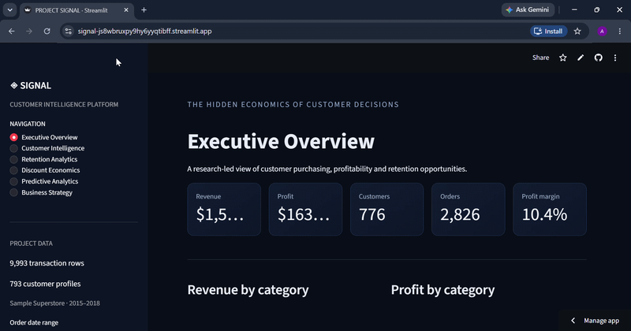
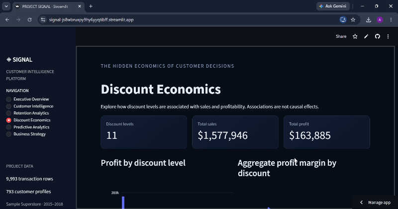

# SIGNAL: Customer Retention and Discount Analytics

> Who are our best customers, who is slipping away, and what do discounts really cost us?

**Live dashboard:** [add your dashboard link here]





*Note: both demos were recorded with the "Office Supplies" filter switched off, so the numbers on screen (776 customers, 2,826 orders, $1.58M sales, 10.4% margin) are smaller than the full totals (793 customers, 5,009 orders, $2.30M sales, 12.5% margin).*

---

## The questions I asked

1. What do customers' buying habits look like? How often do they order, how much do they spend, and how long do they wait between orders?
2. Do higher discounts lower profit?
3. Does the effect of discounts change by product category?
4. Can customers be grouped by Recency, Frequency and Monetary value (RFM)?
5. Which valuable customers have gone quiet and should be contacted first?
6. Can past buying behaviour predict who will buy again in the next 90 days?
7. What should a business do about retention, based on this evidence?

## What I did

I used the Sample Superstore data (2015–2018) and worked in these steps, all inside one notebook:

1. **Checked and cleaned the data.** I looked for missing values and duplicates, removed 1 duplicate row, and fixed the format of money, percentages and dates. I also checked that the profit numbers made sense.
2. **Built an order table and a customer table.** 9,993 order lines became 5,009 orders and 793 customers.
3. **Studied customer behaviour.** I looked at how many orders each customer placed, the time between orders, and how order count relates to profit.
4. **Studied discounts.** I measured profit margin at each discount level, by category and by sub-category. Then I ran statistical tests: a regression, a check that compares the same product at different discounts, and a comparison of 0% vs 20% discount in each category.
5. **Made RFM segments.** Each customer got a 1–5 score for Recency (how recently they bought), Frequency (how often) and Monetary value (how much). I then placed customers into 8 segments such as Champions, Loyal Customers, At Risk and Hibernating.
6. **Found customers to contact first.** For the At Risk group, I compared how long each customer has been quiet with their normal gap between orders. Profitable customers who were far overdue became the top priority.
7. **Tested a prediction model.** I tried to predict who would buy again within 90 days. I used 11 quarter-end snapshots: the first 5 for training, the next 3 for validation, and the last 3 (all in 2018) as a final test. I compared a simple model, a random forest, and versions with calendar features, and checked how well each ranked customers.
8. **Wrote retention ideas and saved the results.** I exported the data and model so a Streamlit dashboard could show them.

## What I found

**1. Almost every customer is a repeat customer.**
781 of 793 customers (98.5%) ordered more than once. The average was 6.3 orders, with about 4 months between orders (median 128 days).

**2. More orders means more profit, but not a better margin.**
Customers with 10+ orders earned $673 profit on average. Customers with 1–3 orders earned $54. But the profit margin was about the same in every group (roughly 9–12%). 155 customers (19.5%) lost the business money.

**3. Big discounts lose money.**
Lines with discounts of 30% or more (1,392 lines, 14% of the total) lost $135,372 combined.

| Discount | Profit margin |
|---|---|
| 0% | 29.5% |
| 20% | 11.8% |
| 30% | −10.1% |
| 50% | −34.8% |
| 80% | −180.1% |

Comparing the same product at different discounts gave a similar result, so this is not just because different products get different discounts.

**4. A 20% discount hurts Furniture most.**
Compared with no discount, profit margin fell by 21.8 points in Furniture, 17.8 in Technology and 13.4 in Office Supplies. Furniture also had the weakest margin overall (2.5%, against about 17% for Office Supplies and Technology). Tables and Bookcases lost money overall.

**5. Two segments carry a lot of the profit.**
Champions (110 customers) produced 23.6% of total profit. At Risk customers (only 90 customers) produced 22.9%. At Risk customers used to order often but have gone quiet.

**6. 33 customers should be contacted first.**
Of the 90 At Risk customers, 79 were profitable and 11 lost money. 33 of the profitable ones are at least twice as overdue as their usual order gap. Their past sales were $164,332 and their past profit was $33,384. That is history, not money we are sure to win back.

**7. The prediction model is weak.**
- Using purchase history alone, the model was no better than guessing (test ROC-AUC 0.50).
- Adding the calendar month raised it to 0.57. But inside any single quarter, the model ranked customers no better than chance (0.52, 0.49, 0.49). The small gain comes from knowing that some quarters are busier than others, not from spotting who will come back.
- A random forest looked great on training data (ROC-AUC 0.86) but dropped to 0.53 on validation. That means it memorised the training data.
- When I tested "contact the top 10% by score", those customers were only 1.15 times more likely to buy than the average customer.

*ROC-AUC in plain words: 0.5 means guessing, 1.0 means perfect.*

**So:** do not use this model to decide who to contact. A negative result is still a result.

## What a business could do

- Contact the profitable At Risk customers first, and run it as a small test with a control group.
- Avoid blanket discounts, and be extra careful with discounts of 30% or more.
- Choose who to contact with simple rules (RFM segment, and how overdue a customer is), not with this model.
- Look at profit and repeat purchases together, not just how often someone buys.
- Count the cost of a campaign before saying it made money.

## Limitations

- **Practice data.** Sample Superstore is a Tableau practice dataset. It is not real company data, so the results show the method, not facts about a real business.
- **No customer ID.** I used customer names to tell customers apart.
- **Rounded dollars.** Sales and profit are whole dollars in this copy. Small orders (under $5) give extreme margins, and the supplied Profit Ratio column does not match Profit ÷ Sales on about 40% of rows. I used Profit ÷ Sales.
- **Patterns, not proof.** The data is observational. Discounts were not given at random, so I cannot say discounts *cause* the drop in profit.
- **Almost everyone is a repeat customer.** Only 12 customers bought once, so "repeat vs one-time" cannot be studied well.
- **Small data for prediction.** There are only 11 snapshots covering 4 different months. The same customers appear in training, validation and test, and the share who bought again rose over time (24% to 55%).
- **No cost data.** I had no campaign or marketing costs, so I cannot calculate return on investment.
- **My own segment rules.** The RFM cut-offs were set by me, using rankings within this customer group.
- **Dashboard scope.** The Predictive Analytics page shows how the model performed. It does not make live predictions for customers.

## Future work

- Use real data with customer IDs and campaign costs.
- Run a real test: contact some At Risk customers and keep a similar group as a control. This is the only way to prove a campaign adds profit.
- Add more years of data and holidays, and check seasonality directly.
- Try better signals, such as returns, delivery problems or website visits.
- Try models built for timing, such as "days until next order" or customer lifetime value.
- Add campaign cost and return on investment to the targeting analysis.

---

## The data

- **Source:** Sample Superstore, made by Tableau. This copy comes from the public GitHub repo `mimansha98/Tableau_Dashboards` (`sample-superstore.csv`).
- **Size:** 9,994 rows. After removing 1 exact duplicate: 9,993 order lines, 5,009 orders and 793 customers.
- **Period:** January 2015 to December 2018.
- **Totals:** $2,297,073 sales and $286,359 profit (12.5% margin).

## Files in this repo

| File | What it is |
|---|---|
| `SIGNAL_01_Data_Acquisition.ipynb` | The full analysis notebook, from data loading to model and export |
| `app.py` | The Streamlit dashboard (6 pages: Executive Overview, Customer Intelligence, Retention Analytics, Discount Economics, Predictive Analytics, Business Strategy) |
| `PROJECT_SIGNAL_ARTIFACTS.zip` | The data and saved model the dashboard reads. The app unzips it automatically. |
| `demo.gif`, `demo2.gif` | Short recordings of the dashboard |
| `requirements.txt` | Python packages for the dashboard |

## How to run it

**The notebook:** open `SIGNAL_01_Data_Acquisition.ipynb` in Google Colab and choose Run all. It downloads the dataset from GitHub, so you need an internet connection. At the end it rebuilds the ZIP file.

**The dashboard:**

```bash
pip install -r requirements.txt
streamlit run app.py
```

Keep `app.py` and `PROJECT_SIGNAL_ARTIFACTS.zip` in the same folder.

## Tools

Python, pandas, NumPy, SciPy, statsmodels, scikit-learn, Streamlit and Plotly.

## Author

Built by [@amnafatimaa6-ops](https://github.com/amnafatimaa6-ops).
